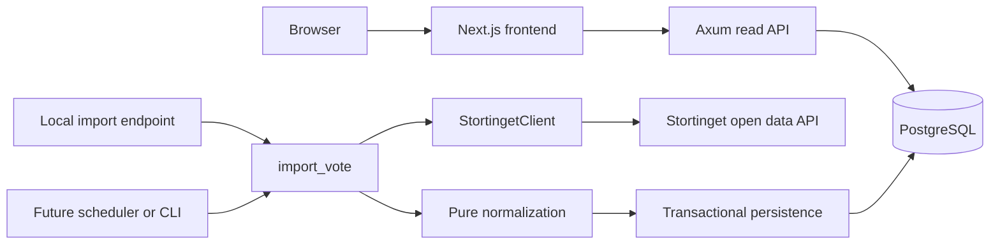

# Storting vote import service

Architecture, implementation contract, and technical guide. Consolidated on 11 October 2026 and aligned with the implementation in `services/rust` on the same date.

This document describes the vote visualizer and its Rust import service. The minimal import path exists: a local import request fetches a vote from Stortinget's API, validates it, commits it to PostgreSQL, and serves it back through the application's API. This has been verified with a manual smoke test against the live API (§15). The automated test suite, request pacing, and retries are still to be built; §20 tracks status.

The initial implementation is deliberately as simple as possible so it is easy to test. Several mechanisms from the original design (an import semaphore, a three-level error model, and some strict validation policies) have been removed or deferred; the relevant sections say so.

## 1. Purpose and selected stack

The application visualizes how representatives and political parties vote in the Norwegian Storting. PostgreSQL holds the application's imported data. Rust owns importing, validation, persistence, and the read API. Next.js provides the React frontend and server-side rendering.

| Concern | Selected technology or approach |
| --- | --- |
| Frontend | Next.js App Router, React, TypeScript |
| Backend HTTP API | Rust, Axum, Tokio |
| Database | PostgreSQL 18, accessed through SQLx |
| Migrations | SQLx migrations in `migrations/`, applied with `sqlx-cli` |
| Upstream HTTP | One reusable Reqwest client |
| Source decoding | Serde and `serde_json` |
| Date normalization | The `time` crate; a small hand-written parser for Stortinget's JSON date format |
| Errors | Typed `thiserror` enums; `anyhow` at executable startup |
| Logging | `tracing` and `tracing-subscriber` |
| JavaScript packages | pnpm |
| JavaScript linting and formatting | Biome |
| Monorepo task orchestration | Turborepo |
| Rust packages and compilation | Cargo |
| Developer commands | Just |
| Toolchain pinning | mise for Node/pnpm/Just; `rust-toolchain.toml` for Rust |
| Automated source tests (planned) | Recorded fixtures and Wiremock |
| Database tests (planned) | Disposable PostgreSQL databases with `#[sqlx::test]` |

The import is an application service function. HTTP handlers, a future CLI, and a future scheduler call the same Rust function. Import logic has no dependency on Axum request types or Next.js.

## 2. Architecture and ownership



The read API uses the `PgPool` from application state directly. It does not go through the importer to read votes.

Create one SQLx pool per running service process and clone its handle where needed. Pool clones share the underlying connections and connection limit; a clone does not create a second pool. An extra `Arc<PgPool>` is unnecessary. [SQLx pool documentation](https://docs.rs/sqlx/latest/sqlx/struct.Pool.html)

Create the Reqwest client and `StortingetClient` once so HTTP connections can be reused. `StortingetClient` is cheap to clone; clones share the underlying connection pool.

There is no `Importer` struct and no import semaphore. `import_vote` is a plain async function that takes the pool, the client, and a command. Concurrent imports are safe without extra locking: the vote upsert takes a row lock, so transactions for the same vote run one after another, and each transaction replaces the complete ballot set (§11).

The first version imports one vote per call and awaits completion. Its API response reports a completed database commit. There is no durable job queue or job-status API in this initial contract.

## 3. Repository, tools, and version ownership

The repository is a pnpm/Turborepo monorepo with one Rust package. The current layout is:

```text
apps/
  web/                         Next.js application
packages/
  typescript-config/           Shared tsconfig files (base, nextjs, react-library)
  ui/                          Shared React components and Tailwind CSS + daisyUI setup
services/
  rust/
    Cargo.toml                 Single package (crate name `rust`)
    Cargo.lock
    package.json               Adapter scripts that invoke Cargo
    src/
      lib.rs                   Exposes all modules to main.rs and tests
      main.rs
      api.rs
      api_dto.rs
      error.rs
      importer.rs
      normalize.rs
      storage.rs
      stortinget_client.rs
      stortinget_models.rs
migrations/                    SQLx migrations, shared by sqlx-cli and tests
docs/
  architecture-design.md
compose.yaml                   Local PostgreSQL
justfile
mise.toml
rust-toolchain.toml
biome.json
package.json
pnpm-workspace.yaml
pnpm-lock.yaml
turbo.json
```

Planned additions: `services/rust/tests/` with `fixtures/`, integration tests for the importer and API, and a `packages/api-client` package with shared frontend API types. A Cargo workspace with a `crates/` directory can be introduced when a second Rust crate is needed.

Keep one Rust service crate initially. `lib.rs` exposes the modules so integration tests and later executable entry points can reuse the implementation. `main.rs` only assembles dependencies and runs the server; it uses the modules through the library (`use rust::...`) and declares no modules of its own.

The command flow is:

```text
Just → pnpm exec turbo → package scripts → Next.js or Cargo
```

Cargo remains responsible for the Rust dependency graph and compiler cache. The Rust `package.json` is only an adapter that makes Cargo tasks (`dev`, `build`, `check`, `lint`, `test`) visible to Turborepo. Keep Rust task caching disabled in Turbo initially; Cargo already handles incremental compilation. Long-running development tasks are persistent and uncached.

Versions are pinned in their owning files:

| File | What it controls | Current pin |
| --- | --- | --- |
| `mise.toml` | Exact Node, pnpm, and Just tool versions | Node 24.21.0, pnpm 12.11.2, Just 1.58.0 |
| Root `package.json` | Exact pnpm version in `packageManager`; Turbo and Biome as project dependencies | pnpm 12.11.2, Biome 2.5.15 |
| `pnpm-lock.yaml` | Resolved JavaScript dependency versions | |
| `rust-toolchain.toml` | Exact Rust toolchain, with rustfmt and Clippy components | Rust 1.99.0 (rustfmt 1.10.0, Clippy 0.1.99) |
| `justfile` | `sqlx-cli` version installed by `just install` | 0.9.0, matching the `sqlx` crate |
| Cargo manifest | Rust dependency requirements and feature selections | |
| `Cargo.lock` | Resolved Rust dependency versions | |

Keep the pnpm versions in mise and `packageManager` synchronized, and keep the `sqlx-cli` version in the justfile in step with the `sqlx` version in `Cargo.lock`. Commit both lockfiles. Use frozen pnpm installs and Cargo's `--locked` option in CI.

`rust-toolchain.toml` is only honored by rustup's proxies. If another Rust installation (for example Homebrew's) is earlier on `PATH`, the pin is silently ignored.

### Local database and migrations

`compose.yaml` runs `postgres:18` with user `vote`, database `vote`, and host port 5433 mapped to the container's 5432. The root `.env` sets `DATABASE_URL=postgres://vote:…@localhost:5433/vote`; both the service (through `dotenvy`) and `sqlx-cli` (through the justfile's `set dotenv-load`) read it.

Migrations live in the root `migrations/` directory and follow SQLx's `<version>_<description>.sql` naming. The relevant Just recipes are:

| Recipe | Behavior |
| --- | --- |
| `just db-up` | Start PostgreSQL and wait until it is healthy |
| `just migrate` | Start PostgreSQL and run `sqlx migrate run` |
| `just migrate-add <name>` | Create a new migration file |
| `just migrate-info` | List applied and pending migrations |
| `just install` | Install JavaScript dependencies, fetch Cargo dependencies, and install the pinned `sqlx-cli` |

The service does not apply migrations at startup; run `just migrate` first.

## 4. Stortinget as the source

Use the official export API with this base URL, including its trailing slash:

```text
https://data.stortinget.no/eksport/
```

Request JSON explicitly with `format=JSON`; the documentation often illustrates XML. The service is publicly accessible, and vote data starts with the 2011–2012 session. Stortinget requires attribution under its published terms. [Service information](https://data.stortinget.no/om-datatjenesten/), [vote-result documentation](https://data.stortinget.no/dokumentasjon-og-hjelp/voteringsresultat/), [usage terms](https://data.stortinget.no/om-datatjenesten/bruksvilkar/)

For a single vote, fetch all three responses:

| Client method | Relative endpoint and query | Purpose |
| --- | --- | --- |
| `votes_for_case(case_id)` | `voteringer?sakid={case_id}&format=JSON` | Find the vote and its published metadata and counts |
| `results(vote_id)` | `voteringsresultat?voteringid={vote_id}&format=JSON` | Representative-level voting records |
| `proposals(vote_id)` | `voteringsforslag?voteringid={vote_id}&format=JSON` | Proposals associated with the vote |

Stortinget documents case `83657` and vote `16897` as an example pair. Importing that pair from the live API produces 169 representative records: 6 for, 80 against, and 83 absent, with one associated proposal. Use recorded responses for that pair as the first fixtures. Treat these numbers as fixture expectations, not constants in application code. [Documented example](https://data.stortinget.no/dokumentasjon-og-hjelp/voteringsresultat/)

Requesting results for a vote ID that does not exist returns a response that does not match the `VoteResults` model and fails to decode. This is one reason the importer checks that the vote belongs to the case before fetching results and proposals (§12).

Future bulk discovery follows sessions → cases → votes → results and proposals. A case contains multiple votes. The reusable single-vote import remains the unit of persistence and validation.

### Source semantics to preserve

- A vote may concern only part of a proposal. Interpret the voting topic together with the proposal text.
- Votes and proposals are not a one-to-one relationship. A proposal may occur in multiple vote records.
- `fri_votering` means that the vote concerns the case as a whole; it does not mean representatives were released from a party whip.
- `personlig_votering` identifies votes with individual voting. Non-individual decisions can legitimately lack representative ballots.
- Preserve alternative-vote IDs and result-type fields in the source data, even before they become queryable columns.

These distinctions follow the source model. [Vote documentation](https://data.stortinget.no/dokumentasjon-og-hjelp/voteringer/), [proposal documentation](https://data.stortinget.no/dokumentasjon-og-hjelp/voteringsforslag/)

An absence is neither opposition nor a synthetic abstention. It is also insufficient for a general attendance metric: Stortinget describes voting practices and pairing arrangements that affect these records. [Source-data caveats](https://data.stortinget.no/dokumentasjon-og-hjelp/kommentar-til-datagrunnlaget-for-voteringer/)

### Request pacing and retries (not yet implemented)

Stortinget currently publishes a limit of 100 API calls per minute; excess requests receive HTTP 429. Use shared pacing of approximately one request per second, including retries, as the initial operating policy. [API limit](https://data.stortinget.no/om-datatjenesten/bruksvilkar/)

Implement this in `StortingetClient` so every caller uses the same rules. The client is cloned into application state, so its limiter state must be shared between clones (for example behind an `Arc`).

Retry transient failures with bounded backoff, honor `Retry-After`, and stop after a configured attempt or elapsed-time limit. Do not repeatedly retry deterministic decoding or validation failures. Never turn an exhausted request failure into an empty successful dataset. Retry counts and delay ceilings remain implementation settings, not established constants.

The current client makes each request once, with no pacing. A single import makes three requests, which is well within the limit. Complete pacing and retries before automated or bulk imports, and test them with a mock server.

## 5. Module responsibilities

| Module | Responsibility |
| --- | --- |
| `lib.rs` | Declare and expose all modules |
| `main.rs` | Read configuration, initialize logging, construct dependencies, start server, coordinate shutdown |
| `api.rs` | `AppState`, routes, request extraction, service calls, responses |
| `api_dto.rs` | Database-read response models and the handler result alias |
| `error.rs` | Import and HTTP error types, conversions, and the HTTP error mapping |
| `stortinget_client.rs` | HTTP requests, timeouts, bytes, decoding (pacing and retries later) |
| `stortinget_models.rs` | Source-shaped DTOs matching the observed JSON contract |
| `normalize.rs` | Pure vote lookup, validation, and conversion into persistence-ready records |
| `storage.rs` | Pool construction, database reads, transactional persistence |
| `importer.rs` | Import command/report and the `import_vote` orchestration function |

Keep environment-variable access at the entry point. Constructors and functions accept dependencies explicitly. Tests can supply a mock base URL and test pool without manipulating global configuration.

## 6. Import command and report

These are defined in `importer.rs`:

```rust
use serde::{Deserialize, Serialize};

#[derive(Debug, Clone, Copy, Deserialize)]
pub struct ImportVote {
    pub case_id: i64,
    pub vote_id: i64,
}

#[derive(Debug, Clone, Serialize)]
pub struct ImportReport {
    pub case_id: i64,
    pub vote_id: i64,
    pub ballot_count: usize,
    pub proposal_count: usize,
}
```

`case_id` allows the importer to verify the vote's membership in the requested case. Numeric source IDs use `i64`, matching PostgreSQL `BIGINT`.

The report counts the dataset saved by this import, including absent representative records. It does not count inserted versus updated rows. Re-importing unchanged data returns the same report. Returning `Ok(ImportReport)` means persistence committed successfully; failures are represented by `ImportError`.

Serde derives are sufficient for the shared command/report. Keep these types independent of Axum. A scheduler can construct `ImportVote` directly.

## 7. Source DTOs and raw responses

Source DTOs preserve Stortinget's field names. Business-facing names appear in normalized records and API responses.

Important decoding rules:

- JSON case, vote, and proposal IDs are numeric; representative, party, and constituency IDs are strings.
- Source enum fields are numeric in the observed JSON, even when XML examples use words.
- JSON dates use strings such as `/Date(1622552993113+0200)/`.
- Nullable fields use `Option<T>`.
- Leave mandatory root lists as `Vec<T>` without a Serde default. A missing required list must cause an error rather than appear as an empty successful result.
- Ignore unmodeled fields during deserialization and retain the original bytes for inspection and future reprocessing.

The source types are:

```rust
use serde::{Deserialize, Serialize};

#[derive(Debug, Clone, Deserialize)]
pub struct CaseVotes {
    pub sak_id: i64,
    pub sak_votering_liste: Vec<CaseVote>,
}

#[derive(Debug, Clone, Deserialize)]
pub struct CaseVote {
    pub sak_id: i64,
    pub votering_id: i64,
    pub alternativ_votering_id: i64,
    pub votering_tid: String,
    pub votering_tema: Option<String>,
    pub vedtatt: bool,
    pub personlig_votering: bool,
    pub fri_votering: bool,
    pub antall_for: i32,
    pub antall_mot: i32,
    pub antall_ikke_tilstede: i32,
    pub behandlingsrekkefoelge: i32,
    pub mote_kart_nummer: i32,
    pub dagsorden_sak_nummer: i32,
    pub kommentar: Option<String>,
    pub president: Option<Representative>,
    pub votering_metode: Option<i32>,
    pub votering_resultat_type: i32,
    pub votering_resultat_type_tekst: Option<String>,
}

#[derive(Debug, Clone, Deserialize)]
pub struct VoteResults {
    pub votering_id: i64,
    pub voteringsresultat_liste: Vec<RepresentativeVote>,
}

#[derive(Debug, Clone, Deserialize)]
pub struct RepresentativeVote {
    pub representant: Representative,
    pub vara_for: Option<Person>,
    pub fast_vara_for: Option<Person>,
    pub votering: i32,
}

#[derive(Debug, Clone, Deserialize)]
pub struct Representative {
    pub id: String,
    pub fornavn: String,
    pub etternavn: String,
    pub parti: Option<Party>,
    pub fylke: Option<Constituency>,
    pub vara_representant: Option<bool>,
}

#[derive(Debug, Clone, Deserialize)]
pub struct Person {
    pub id: String,
    pub fornavn: String,
    pub etternavn: String,
}

#[derive(Debug, Clone, Deserialize, Serialize)]
pub struct Party {
    pub id: String,
    pub navn: String,
}

#[derive(Debug, Clone, Deserialize)]
pub struct Constituency {
    pub id: String,
    pub navn: String,
}

#[derive(Debug, Clone, Deserialize)]
pub struct VoteProposals {
    pub votering_id: i64,
    pub voteringsforslag_liste: Vec<VoteProposal>,
}

#[derive(Debug, Clone, Deserialize, Serialize)]
pub struct VoteProposal {
    pub forslag_id: i64,
    pub forslag_betegnelse: Option<String>,
    pub forslag_betegnelse_kort: Option<String>,
    pub forslag_tekst: Option<String>,
    pub forslag_paa_vegne_av_tekst: Option<String>,
    pub forslag_levert_av_representant: Option<String>,
    pub forslag_levert_av_parti_liste: Option<Vec<Party>>,
    pub forslag_sorteringsnummer: i32,
    pub forslag_type: i32,
}
```

`votering_metode` was absent in the inspected JSON, so it is optional. The person records inside `vara_for` and `fast_vara_for` have a smaller shape than a voting representative. Proposal text can contain HTML; storing it does not make it safe to render as unrestricted HTML in the frontend.

Every non-optional field is a reason decoding can fail, and most `CaseVote` and `Representative` fields are not used by normalization. Trimming the models to the fields actually used is a known possible simplification; the raw bodies in `source_snapshots` retain everything regardless.

`VoteProposal` and `Party` derive `Serialize` because proposals are persisted as JSONB in the initial schema. That serialization is a projection of known fields; the raw response retains any unmodeled fields.

Every successful client fetch returns both decoded data and its original body:

```rust
pub struct Fetched<T> {
    pub url: reqwest::Url,
    pub raw: bytes::Bytes,
    pub data: T,
}
```

## 8. StortingetClient contract

The client holds a reusable `reqwest::Client` and a configured export base URL, and derives `Clone`. Its public API is:

```rust
pub fn new(http: reqwest::Client, export_base: reqwest::Url) -> Self;

pub async fn votes_for_case(
    &self,
    case_id: i64,
) -> Result<Fetched<CaseVotes>, ImportError>;

pub async fn results(
    &self,
    vote_id: i64,
) -> Result<Fetched<VoteResults>, ImportError>;

pub async fn proposals(
    &self,
    vote_id: i64,
) -> Result<Fetched<VoteProposals>, ImportError>;
```

All three methods share one private `get` helper, which:

1. Joins the relative endpoint onto the configured base URL. The endpoints are fixed relative paths, so joining can only fail for a base URL that cannot have paths; that is a startup configuration bug and the helper panics with `expect`.
2. Appends the ID parameter and `format=JSON` using URL query methods.
3. Sends the request (shared pacing and bounded retries are to be added here).
4. Rejects an unsuccessful HTTP status with `error_for_status`.
5. Reads the complete body as bytes.
6. Deserializes with `serde_json::from_slice`.
7. Returns the requested URL, original bytes, and decoded DTO.

Explicit byte decoding keeps transport and status failures as `ImportError::Request(reqwest::Error)` and JSON failures as `ImportError::Decode(serde_json::Error)`. A source response with HTTP 404 remains a source request error; it does not automatically mean the application's own resource is missing.

The HTTP client is built once in `main`:

```rust
let http = reqwest::Client::builder()
    .user_agent("vote-visualizer-importer/0.1")
    .connect_timeout(std::time::Duration::from_secs(5))
    .timeout(std::time::Duration::from_secs(20))
    .build()?;
```

The 20-second setting is a request timeout, not a total import deadline. Three sequential fetches, and later pacing and retries, can make the overall import longer. Tests inject a Wiremock server's base URL; production uses the official export URL.

## 9. Normalization contract

Normalization is split into two synchronous, pure functions. They perform no network access, database access, logging-dependent behavior, or environment reads.

```rust
pub fn find_case_vote(
    command: ImportVote,
    case_votes: &CaseVotes,
) -> Result<&CaseVote, ImportError>;

pub fn normalize_vote(
    command: ImportVote,
    vote: &CaseVote,
    results: &VoteResults,
    proposals: &VoteProposals,
) -> Result<NormalizedVote, ImportError>;
```

`find_case_vote` runs on the first response, before results and proposals are fetched. `normalize_vote` runs once all three responses are available.

The output types are:

```rust
use time::OffsetDateTime;
use crate::stortinget_models::VoteProposal;

#[derive(Debug)]
pub struct NormalizedVote {
    pub case_id: i64,
    pub vote_id: i64,
    pub voted_at: OffsetDateTime,
    pub subject: Option<String>,
    pub adopted: bool,
    pub individual: bool,
    pub for_count: i32,
    pub against_count: i32,
    pub absent_count: i32,
    pub ballots: Vec<NormalizedBallot>,
    pub proposals: Vec<VoteProposal>,
}

#[derive(Debug)]
pub struct NormalizedBallot {
    pub representative_id: String,
    pub party_id: Option<String>,
    pub choice: VoteChoice,
}

#[derive(Debug, Clone, Copy, PartialEq, Eq)]
pub enum VoteChoice {
    For,
    Against,
    Absent,
}

impl VoteChoice {
    pub fn as_str(self) -> &'static str {
        match self {
            Self::For => "for",
            Self::Against => "against",
            Self::Absent => "absent",
        }
    }
}
```

### Validation and mapping sequence

All checks run before a database transaction starts.

`find_case_vote`:

1. Require `case_votes.sak_id == command.case_id`.
2. Find exactly one vote with the requested `votering_id` in the case response. A missing vote produces `ImportError::NotFound`; duplicate matching votes produce `InvalidSourceData`.

`normalize_vote`:

3. Require both results and proposals root `votering_id` values to match the command.
4. Reject an empty representative ID and duplicate representative IDs within the ballot set.
5. Convert each representative vote code through an explicit match. Reject unsupported codes.
6. Copy `party_id` from that representative's source voting record. Preserve a missing party as `None`; do not infer it from a current roster.
7. For individual voting, require a nonempty ballot set and require its for/against/absent counts to equal the published counts.
8. Parse the source timestamp and construct `NormalizedVote`.

The observed JSON-to-XML mapping for the example fixture is:

| JSON code | XML value | Normalized value |
| --- | --- | --- |
| `1` | `ikke_tilstede` | `Absent` |
| `2` | `for` | `For` |
| `3` | `mot` | `Against` |

Keep a test for this mapping. Do not silently assign a meaning to new values. Other numeric metadata such as proposal type is retained as source data until the application needs to interpret it.

The normalized scalar mapping is:

| Source field | Normalized field |
| --- | --- |
| `sak_id` | `case_id` |
| `votering_id` | `vote_id` |
| `votering_tid` | `voted_at`, parsed to UTC |
| `votering_tema` | `subject` |
| `vedtatt` | `adopted` |
| `personlig_votering` | `individual` |
| `antall_for` | `for_count` |
| `antall_mot` | `against_count` |
| `antall_ikke_tilstede` | `absent_count` |

For individual ballots, counts are compared using `i64` accumulators. Do not hard-code 169 representatives as the condition for success; validate against the response's own published counts.

The following checks from the original design were removed to keep the first version simple:

| Removed check | What happens now |
| --- | --- |
| Negative published counts | For individual votes, the count comparison rejects them. Otherwise the `CHECK` constraints in the schema reject them at insert time, which surfaces as a database error (HTTP 500) rather than invalid source data. |
| The selected vote's own `sak_id` matches the case | Not rechecked; the root `sak_id` of the case response is checked. |
| Duplicate proposal IDs within a vote | Not checked; proposals are stored as a JSON array. |
| Non-individual vote with individual ballots | Accepted and stored as-is. |

The count check is a deliberately strict policy. It surfaces inconsistent source responses while preserving previously valid data; it is not a promise that every historical response will satisfy it. Three separate HTTP requests are not an atomic snapshot of Stortinget. If the source changes between requests, reject the mismatch and investigate or retry the complete import later.

### Timestamp conversion

The parser recognizes the complete `/Date(milliseconds[optional offset])/` wrapper, extracts the signed milliseconds, and converts them to an `OffsetDateTime` in UTC. The milliseconds identify the UTC instant; the optional offset is not applied a second time. The implementation uses plain string handling instead of a regular expression:

```rust
/// Parses `/Date(milliseconds[+-HHMM])/`, e.g. `/Date(1622552993113+0200)/`.
fn parse_source_date(value: &str) -> Result<OffsetDateTime, ImportError> {
    let malformed = || invalid(format!("invalid source date: {value}"));
    let is_digits = |s: &str| !s.is_empty() && s.bytes().all(|b| b.is_ascii_digit());

    let inner = value
        .strip_prefix("/Date(")
        .and_then(|rest| rest.strip_suffix(")/"))
        .ok_or_else(malformed)?;

    // Split off the optional offset, skipping a leading minus on the milliseconds.
    let sign_len = usize::from(inner.starts_with('-'));
    let (millis, offset) = match inner[sign_len..].find(['+', '-']) {
        Some(index) => inner.split_at(sign_len + index),
        None => (inner, ""),
    };

    if !is_digits(&millis[sign_len..])
        || !(offset.is_empty() || offset.len() == 5 && is_digits(&offset[1..]))
    {
        return Err(malformed());
    }

    let milliseconds = millis
        .parse::<i64>()
        .map_err(|_| invalid(format!("source date out of range: {value}")))?;

    // The milliseconds already identify the UTC instant.
    // Do not apply the optional offset a second time.
    OffsetDateTime::from_unix_timestamp_nanos(i128::from(milliseconds) * 1_000_000)
        .map_err(|_| invalid(format!("source date out of range: {value}")))
}
```

Note that the input is milliseconds; passing it to `from_unix_timestamp` (which expects seconds) would push every date past year 9999 and reject it.

Unit tests in `normalize.rs` cover a date with and without an offset, a negative timestamp, malformed wrappers (empty, missing wrapper, empty or sign-only milliseconds, a leading `+`, short, non-numeric, or repeated offsets), and overflow. The optional offset is accepted as a source annotation; the parser does not interpret or validate it as a civil-time timezone.

## 10. PostgreSQL schema

The initial schema is the migration `migrations/20261011154300_initial_tables.sql`. It stores queryable vote metadata, representative ballots, proposal JSON, and the latest successful raw source bodies.

```sql
CREATE TABLE votes (
    id BIGINT PRIMARY KEY,
    case_id BIGINT NOT NULL,
    voted_at TIMESTAMPTZ NOT NULL,
    subject TEXT,
    adopted BOOLEAN NOT NULL,
    individual BOOLEAN NOT NULL,
    for_count INTEGER NOT NULL CHECK (for_count >= 0),
    against_count INTEGER NOT NULL CHECK (against_count >= 0),
    absent_count INTEGER NOT NULL CHECK (absent_count >= 0),
    proposals JSONB NOT NULL,
    imported_at TIMESTAMPTZ NOT NULL DEFAULT now()
);

CREATE INDEX votes_case_id_idx ON votes (case_id);

CREATE TABLE ballots (
    vote_id BIGINT NOT NULL REFERENCES votes(id) ON DELETE CASCADE,
    representative_id TEXT NOT NULL,
    party_id TEXT,
    choice TEXT NOT NULL CHECK (choice IN ('for', 'against', 'absent')),
    PRIMARY KEY (vote_id, representative_id)
);

CREATE TABLE source_snapshots (
    vote_id BIGINT NOT NULL REFERENCES votes(id) ON DELETE CASCADE,
    kind TEXT NOT NULL,
    source_url TEXT NOT NULL,
    body BYTEA NOT NULL,
    saved_at TIMESTAMPTZ NOT NULL DEFAULT now(),
    PRIMARY KEY (vote_id, kind)
);
```

There is no case, representative, or party master table in this minimal schema. Source IDs are stored directly. Names, constituency data, substitutions, alternative-vote relationships, and additional result metadata remain in the raw responses until needed as queryable data.

Proposals are stored as an array of known proposal DTOs in `votes.proposals`. A proposal appearing in another vote is valid. A later relational proposal model must preserve this relationship.

`source_snapshots` has three rows per successfully imported vote, using the kinds `case_votes`, `vote_results`, and `vote_proposals`. The complete response bodies are stored in `BYTEA`, including the whole case-votes response. Re-importing overwrites these rows. This is a latest-successful-source store, not an audit history. Failed fetches or rejected payloads are not persisted.

`imported_at` and `saved_at` use database transaction time. They are neither upstream publication times nor exact HTTP fetch times. The vote's actual time is `voted_at`.

## 11. Persistence and transaction boundary

`storage::insert_vote` owns the transaction. The importer does not begin or commit another transaction around it.

```rust
pub struct SourceSnapshot<'a> {
    pub kind: &'a str,
    pub url: &'a str,
    pub body: &'a [u8],
}

pub(crate) async fn insert_vote(
    pool: &sqlx::PgPool,
    vote: &NormalizedVote,
    snapshots: &[SourceSnapshot<'_>],
) -> Result<(), sqlx::Error>;
```

Persistence runs in this order:

1. Begin one transaction from the pool.
2. Upsert the vote by `votes.id`, including its complete proposals array and refreshed import timestamp.
3. Delete the existing ballots for that vote.
4. Insert every ballot from the validated replacement set.
5. Upsert the three source snapshots by `(vote_id, kind)`.
6. Commit.

All values use parameterized SQL. Every query in the function executes through `&mut *tx`, never through the pool. SQLx rolls back an unfinished transaction when it is dropped. [SQLx transaction documentation](https://docs.rs/sqlx/latest/sqlx/struct.Transaction.html)

The central upsert is:

```sql
INSERT INTO votes (
    id, case_id, voted_at, subject, adopted, individual,
    for_count, against_count, absent_count, proposals
)
VALUES ($1, $2, $3, $4, $5, $6, $7, $8, $9, $10)
ON CONFLICT (id) DO UPDATE SET
    case_id = EXCLUDED.case_id,
    voted_at = EXCLUDED.voted_at,
    subject = EXCLUDED.subject,
    adopted = EXCLUDED.adopted,
    individual = EXCLUDED.individual,
    for_count = EXCLUDED.for_count,
    against_count = EXCLUDED.against_count,
    absent_count = EXCLUDED.absent_count,
    proposals = EXCLUDED.proposals,
    imported_at = now();
```

Proposals are bound with `sqlx::types::Json(&vote.proposals)` and ballot choices with `VoteChoice::as_str()`.

The replacement statements are:

```sql
DELETE FROM ballots WHERE vote_id = $1;

INSERT INTO ballots (vote_id, representative_id, party_id, choice)
VALUES ($1, $2, $3, $4);

INSERT INTO source_snapshots (vote_id, kind, source_url, body)
VALUES ($1, $2, $3, $4)
ON CONFLICT (vote_id, kind) DO UPDATE SET
    source_url = EXCLUDED.source_url,
    body = EXCLUDED.body,
    saved_at = now();
```

The ballot insert runs once per ballot and the snapshot upsert once per snapshot. A straightforward insertion loop is sufficient for the single-vote importer.

Deleting and reinserting ballots is intentional. It removes rows that disappear from a corrected source response, which a pure insert/upsert loop would leave behind. The transaction ensures readers do not observe the intermediate deletion.

Because the vote upsert is the first statement, it takes the vote's row lock for the rest of the transaction. A concurrent import of the same vote waits on that lock and then replaces the complete ballot set again, so the end state is always one consistent ballot set. This is why no import semaphore is needed.

Idempotency means repeated imports leave one logical vote and the current ballot set. Import timestamps can change and SQL updates still occur. It does not mean the second import performs no writes.

## 12. Import orchestration

The application service is a function in `importer.rs`:

```rust
use crate::error::ImportError;
use crate::normalize::{find_case_vote, normalize_vote};
use crate::storage::{SourceSnapshot, insert_vote};
use crate::stortinget_client::StortingetClient;
use sqlx::PgPool;

pub async fn import_vote(
    pool: &PgPool,
    source: &StortingetClient,
    command: ImportVote,
) -> Result<ImportReport, ImportError> {
    // Finish HTTP requests before opening a database transaction.
    let case_votes = source.votes_for_case(command.case_id).await?;
    let case_vote = find_case_vote(command, &case_votes.data)?;

    let results = source.results(command.vote_id).await?;
    let proposals = source.proposals(command.vote_id).await?;

    let vote = normalize_vote(command, case_vote, &results.data, &proposals.data)?;

    let snapshots = [
        SourceSnapshot {
            kind: "case_votes",
            url: case_votes.url.as_str(),
            body: case_votes.raw.as_ref(),
        },
        SourceSnapshot {
            kind: "vote_results",
            url: results.url.as_str(),
            body: results.raw.as_ref(),
        },
        SourceSnapshot {
            kind: "vote_proposals",
            url: proposals.url.as_str(),
            body: proposals.raw.as_ref(),
        },
    ];

    insert_vote(pool, &vote, &snapshots).await?;

    Ok(ImportReport {
        case_id: vote.case_id,
        vote_id: vote.vote_id,
        ballot_count: vote.ballots.len(),
        proposal_count: vote.proposals.len(),
    })
}
```

The vote's membership in the case is checked immediately after the first fetch. A vote outside the requested case returns `NotFound` without fetching its results or proposals, which avoids two unnecessary requests and the decode failure Stortinget's response for a nonexistent vote would cause.

The flow also fetches results for non-individual votes. It expects a successful response containing an empty list when individual records are absent. An upstream 404 is still an error; it is not converted into an empty ballot set.

All HTTP work finishes before the write transaction begins. A request, decoding, or validation failure therefore leaves existing database data untouched. A persistence failure before a successful commit rolls back the writes. A lost connection during commit can leave the client uncertain about the database outcome; retrying the same import is safe because the persistence operation is idempotent.

There is no concurrency limit on imports. Concurrent calls are safe for the database (§11). When pacing is added to `StortingetClient`, it will also bound the combined upstream request rate of concurrent imports.

## 13. Error model

There are two error enums, with no boxed or catch-all variants:

```text
Reqwest / JSON failure, validation failure, SQLx write failure → ImportError → ApiError → HTTP
SQLx read failure                                                            → ApiError → HTTP
```

```rust
#[derive(Debug, thiserror::Error)]
pub enum ImportError {
    #[error("resource not found: {message}")]
    NotFound { message: String },

    #[error("invalid source data: {message}")]
    InvalidSourceData { message: String },

    // Includes connection failures, timeouts, body-read failures,
    // and HTTP status errors from error_for_status().
    #[error("Stortinget request failed")]
    Request(#[from] reqwest::Error),

    #[error("failed to deserialize Stortinget response")]
    Decode(#[from] serde_json::Error),

    #[error("database operation failed")]
    Database(#[from] sqlx::Error),
}

#[derive(Debug, thiserror::Error)]
pub enum ApiError {
    #[error("resource not found: {message}")]
    NotFound { message: String },

    #[error("import failed")]
    Import(#[from] ImportError),

    #[error("database operation failed")]
    Database(#[from] sqlx::Error),
}
```

The `#[from]` attributes let `?` convert client, decoding, and database errors at each function boundary.

The API mapping is:

| Error | HTTP status | Public message |
| --- | --- | --- |
| `ApiError::NotFound` or `ImportError::NotFound` | 404 | The explicitly safe not-found message |
| `InvalidSourceData`, `Request`, or `Decode` | 502 | `upstream request failed` |
| `Database` (import or read) | 500 | `internal server error` |

Only deliberately constructed, safe `NotFound` messages are exposed. SQL errors, source payloads, and detailed validation failures are never included in HTTP responses. Distinguishing upstream timeouts (504) and finer-grained upstream messages can be added later if the frontend needs them.

`ApiError::into_response` calls the mapping, logs server errors (5xx) with `tracing::error!` including the full error, and returns a status plus this JSON shape:

```json
{"error":"upstream request failed"}
```

A CLI or scheduler uses `ImportError` directly; it does not convert failures into HTTP responses.

## 14. Application state and startup

Application state is defined in `api.rs`:

```rust
#[derive(Clone)]
pub struct AppState {
    pub pool: PgPool,
    pub source: StortingetClient,
}
```

All handlers extract `State<AppState>`. Read handlers use `state.pool` and never touch `state.source`. `Router<AppState>` describes a router that still needs its state; `main` supplies it once with `.with_state(state)`. [Axum state documentation](https://docs.rs/axum/latest/axum/extract/struct.State.html)

Startup sequence in `main.rs`:

1. Load local `.env` values with `dotenvy` and initialize tracing.
2. Read `DATABASE_URL`.
3. Create the SQLx pool through `storage::establish_connection` (max 50 connections, 3-second acquire timeout, 10-second idle timeout).
4. Log pool size, idle connections, min/max connections, acquire timeout, and idle timeout.
5. Build the Reqwest client and `StortingetClient`.
6. Construct `AppState { pool: pool.clone(), source }`.
7. Build `api::router().with_state(state)`.
8. Bind the local development server to `127.0.0.1:8080`, log its address, and serve.
9. On Ctrl-C, stop accepting work, let in-flight requests finish, then close the pool.

Migrations are not applied at startup; run `just migrate` before starting the service, or make the deployment's migration step complete first.

The dependency construction at the center of `main` is:

```rust
let source = StortingetClient::new(http, "https://data.stortinget.no/eksport/".parse()?);
let state = AppState {
    pool: pool.clone(),
    source,
};
let app = router().with_state(state);

let listener = tokio::net::TcpListener::bind("127.0.0.1:8080").await?;

axum::serve(listener, app)
    .with_graceful_shutdown(async {
        if let Err(error) = tokio::signal::ctrl_c().await {
            tracing::error!(%error, "failed to listen for shutdown");
        }
    })
    .await?;

pool.close().await;
```

When deploying under a process manager or container runtime, also handle its termination signal.

Keep the local development trigger on the local interface. Production invocation and access control are deployment concerns; the development route is not a public user feature.

## 15. HTTP API

| Method and path | Behavior |
| --- | --- |
| `POST /dev/imports/vote` | Await a single import and return its report after commit |
| `GET /votes/{id}` | Read an imported vote, with its ballots, from PostgreSQL |
| `GET /health` | Liveness only: returns `200 OK` with the body `OK`; it does not check the database |

### Import

```http
POST /dev/imports/vote
Content-Type: application/json

{"case_id":83657,"vote_id":16897}
```

A successful response uses HTTP 200:

```json
{
  "case_id": 83657,
  "vote_id": 16897,
  "ballot_count": 169,
  "proposal_count": 1
}
```

The handler is small:

```rust
async fn post_dev_imports_vote(
    State(state): State<AppState>,
    Json(command): Json<ImportVote>,
) -> ApiResult<ImportReport> {
    let report = importer::import_vote(&state.pool, &state.source, command).await?;

    Ok(Json(report))
}
```

A vote that is not in the requested case returns 404, for example `{"error":"vote 1 was not found in case 83657"}`.

### Read

`GET /votes/{id}` takes a numeric ID. The response, defined by `VoteDto` in `api_dto.rs`, is:

```json
{
  "id": 16897,
  "case_id": 83657,
  "voted_at": "2021-06-01T13:09:53.113Z",
  "subject": "Forslag nr. 7 på vegne av SV.",
  "adopted": false,
  "individual": true,
  "for_count": 6,
  "against_count": 80,
  "absent_count": 83,
  "proposals": [{ "forslag_id": 40063831, "...": "stored proposal fields" }],
  "ballots": [
    { "representative_id": "...", "party_id": "SV", "choice": "for" }
  ],
  "imported_at": "2026-10-11T16:33:40.123Z"
}
```

Timestamps are RFC 3339 in UTC. `proposals` is the stored JSON array as-is. `ballots` is ordered by `representative_id`, and `party_id` can be `null`. An unknown ID returns 404 `{"error":"vote {id} not found"}`.

`storage::find_vote` reads the vote and its ballots in one SQL statement, with the ballots aggregated by a `json_agg` subquery. Because it is a single statement, the vote and its ballots always come from the same snapshot, even while an import is replacing the ballots. The row is decoded into `VoteRow` and converted to `VoteDto`.

### Manual smoke test

```sh
just migrate
pnpm --filter @votes/rust dev   # or: cargo run inside services/rust

curl --fail-with-body \
  -H 'Content-Type: application/json' \
  -d '{"case_id":83657,"vote_id":16897}' \
  http://127.0.0.1:8080/dev/imports/vote

curl --fail-with-body http://127.0.0.1:8080/votes/16897
```

Repeat the import and verify that exactly one vote row, 169 ballots, and three source snapshots remain. This smoke test passed against the live API on 11 October 2026.

## 16. Test strategy

The normal test suite must work without contacting Stortinget. Exercise the real Reqwest client against Wiremock and use real PostgreSQL for storage behavior. Source DTOs, normalization, transactions, and HTTP boundaries each need coverage appropriate to their role.

Currently implemented: unit tests for `parse_source_date` in `normalize.rs` (§9). Everything else in this section is planned.

### Fixture and normalization tests

Store recorded JSON under `services/rust/tests/fixtures`, including case votes, results, and proposals for the example pair. Preserve originals and derive explicit modified fixtures for failure cases. Test that the DTOs decode actual source payloads rather than only hand-written simplified JSON.

| Scenario | Required outcome |
| --- | --- |
| Valid example | Expected normalized fields, counts, proposal IDs, and UTC timestamp |
| Source enum mapping | 1 → absent, 2 → for, 3 → against |
| Unknown ballot code | `InvalidSourceData`; no guessed value |
| Missing required root list | JSON decode failure |
| Wrong case ID in case response | `find_case_vote` validation failure |
| Wrong vote ID in results or proposals | `normalize_vote` validation failure |
| Vote absent from requested case | `NotFound` from `find_case_vote` |
| Duplicate matching vote | Validation failure |
| Duplicate or empty representative ID | Validation failure |
| Individual counts disagree | Validation failure |
| Individual vote has no ballots | Validation failure |
| Non-individual vote has no ballots | Success without generated ballots |
| Missing party | Preserved as `None` |
| Invalid or out-of-range date | Validation failure (covered by the existing unit tests) |

### Client tests

Run Wiremock on a random local port. Point a real `StortingetClient` at it. Check endpoint paths, ID parameters, and `format=JSON`. Return the recorded fixtures and assert that both typed data and original bytes are preserved. Test unsuccessful HTTP status, timeout, and malformed JSON, and later pacing and retry behavior. [Wiremock documentation](https://docs.rs/wiremock/latest/wiremock/)

### PostgreSQL integration tests

Use `#[sqlx::test]` with the root `migrations/` directory and an injected `PgPool`. For PostgreSQL's automatic per-test database setup, the test connection needs database-creation permissions; the local `vote` user created by the Postgres image has them. Give CI a disposable PostgreSQL service. [SQLx test documentation](https://docs.rs/sqlx/latest/sqlx/attr.test.html)

Test these invariants:

1. Successful import writes the vote, full ballot set, proposal JSON, and exact raw bytes.
2. Importing the same fixture twice creates no duplicate logical records.
3. A corrected fixture updates vote metadata and replaces proposals and ballots.
4. A ballot removed from a corrected fixture disappears from the database. Adjust fixture totals so normalization still succeeds.
5. A changed party or choice is persisted correctly.
6. A failure after writes have begun rolls back the vote update, ballot deletion/inserts, and snapshot changes together.
7. Source fetch or normalization failures leave existing rows unchanged.
8. A vote outside the requested case makes only the case-votes request.

For the rollback test, call `insert_vote` directly with controlled invalid data (for example a negative count, which violates a `CHECK` constraint after earlier statements succeed), or use a test-only trigger that fails a later statement. The purpose is to prove atomicity after a write has actually occurred; a source failure before `begin` cannot prove rollback.

### API tests

Build the real router with a test pool and a `StortingetClient` pointed at Wiremock, and call `import_vote` directly where the HTTP layer is not under test. Exercise POST → GET, and assert response status, report, and persisted data. Test the 404, 502, and 500 mappings without leaking internal messages.

Keep a separate opt-in live smoke test for current upstream compatibility. Do not make routine CI depend on Stortinget's availability or unchanged live counts.

## 17. Future CLI, scheduling, and bulk imports

A future scheduler calls the same function:

```rust
let report = importer::import_vote(
    &pool,
    &source,
    ImportVote {
        case_id: 83657,
        vote_id: 16897,
    },
)
.await?;
```

A scheduler running in the API process uses clones of the same pool and `StortingetClient`, so it shares connections and, once implemented, the client's pacing state.

For deployment, a scheduled Rust executable can construct its own dependencies and call the library. An external scheduler launches that executable. Its pool and client are separate from the API process, so account for the combined database connection budget and upstream request rate.

Concurrent imports of the same vote are already safe for the database across processes, because the protection is the vote's row lock (§11), not in-process state. What does not span processes is request pacing: before running several importer processes, coordinate their upstream request rate, or serialize full imports with a correctly scoped PostgreSQL advisory lock.

For larger imports, discover sessions and cases, then process vote commands through the shared function. Avoid concurrent floods of requests. Re-fetch recent data to capture corrections. Keep failures visible and preserve existing data until a complete replacement is validated and committed.

The import operation is repeatable but not a durable background job. Process termination or a lost HTTP response does not provide a job-status record. A caller can safely repeat the same command, including when it did not receive the prior success response.

## 18. Next.js integration and presentation

Next.js Server Components fetch the Axum read API directly for initial rendering. Interactive browser requests can use explicit Next.js route handlers to reach the backend. Keep import credentials, database access, and source orchestration in the backend.

PostgreSQL is the source for application reads. Avoid making public page requests trigger imports. The frontend should be able to serve the last successfully imported dataset while Stortinget is unavailable.

The chosen frontend caching direction is explicit cache tags and revalidation after successful imports. When implementing that integration, publish invalidation only after the database transaction commits. Reliable delivery can use a transactional outbox alongside the import; this is a later integration and is not part of the three-table initial schema. Revalidation affects subsequent reads and does not push new data into an already open browser by itself.

Use the stored source URLs for attribution and traceability. Display the voting topic together with relevant proposal text. Preserve absence as its own category and handle missing party attribution explicitly. Before publishing party agreement percentages, define the denominator and how non-individual, procedural, and alternative votes are treated; the importer should preserve evidence rather than invent that analysis policy.

The intended deployment keeps Next.js, the Rust API, importer execution, and PostgreSQL near one another, with private backend/database access where practical. The exact hosting provider and deployment configuration remain to be chosen.

## 19. Dependencies and features

The current `services/rust/Cargo.toml` dependencies:

| Crate | Requirement | Use and features |
| --- | --- | --- |
| `axum` | 0.8 | Router, JSON extraction/responses, state |
| `tokio` | 1, `full` | Async runtime, networking, signals |
| `sqlx` | 0.9.0, `postgres`, `runtime-tokio`, `macros`, `time`, `uuid`, `json` | PostgreSQL access, `time` and JSON types |
| `reqwest` | 0.13.5 | HTTP client with HTTPS support |
| `serde` | 1.0.229, `derive` | DTO derives |
| `serde_json` | 1.0.151 | Decode source bytes, JSON values in read DTOs |
| `bytes` | 1.12.1 | Preserve response bodies |
| `time` | 0.3.55, `macros`, `serde-well-known` | Timestamps, database binding, RFC 3339 serialization in `VoteDto`, `datetime!` in tests |
| `thiserror` | 2.0.20 | Typed errors and conversions |
| `anyhow` | 1.0.104 | Startup errors |
| `dotenvy` | 0.15.7 | Local development configuration |
| `tracing`, `tracing-subscriber` | 0.1, 0.3 | Structured diagnostics |

Compared with the original design: `time` replaces `chrono`; `regex` and `url` are no longer needed (the date parser uses string handling, and URL joining no longer returns an error to the caller). The `uuid` feature on `sqlx` is currently unused.

SQLx's default features are left on, which includes the `migrate` support that `#[sqlx::test]` needs to apply migrations. To add for the planned tests: `wiremock` as a development dependency. Check feature names against the pinned crate releases.

## 20. Implementation order and status

| Step | Status |
| --- | --- |
| 1. Cargo library/binary structure and pinned tooling | Done |
| 2. Migrations, verified on a fresh database | Done (`just migrate`) |
| 3. Source DTOs and fixture decoding tests | DTOs done; fixture tests to do |
| 4. Configurable client and its HTTP error behavior | Done; Wiremock tests to do |
| 5. Normalization and its fixture tests | Done; date-parser unit tests only |
| 6. Transactional persistence and database tests | Persistence done; `#[sqlx::test]` tests to do |
| 7. `import_vote`, `AppState`, the POST trigger, and the read endpoint | Done |
| 8. POST → GET smoke test and repeat-import test | Done manually against the live API |
| 9. Shared pacing and bounded retries before automated import runs | To do |
| 10. Connect Next.js to the read API, then add scheduling and cache invalidation | To do |

The minimal importer is complete when it can import the example through the real service boundaries, serve the saved vote, repeat safely, apply corrections, preserve prior valid data on failure, and pass fixture-backed tests without live upstream access. The first three are verified manually; the rest await the automated test suite.

The service behavior must remain consistent across every entry point: one shared import function, explicit source validation, a single atomic persistence transaction, and success reported only after commit.
